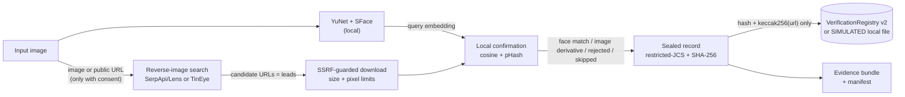
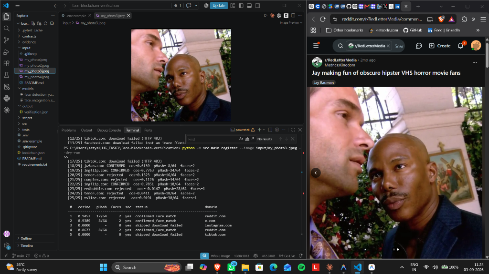
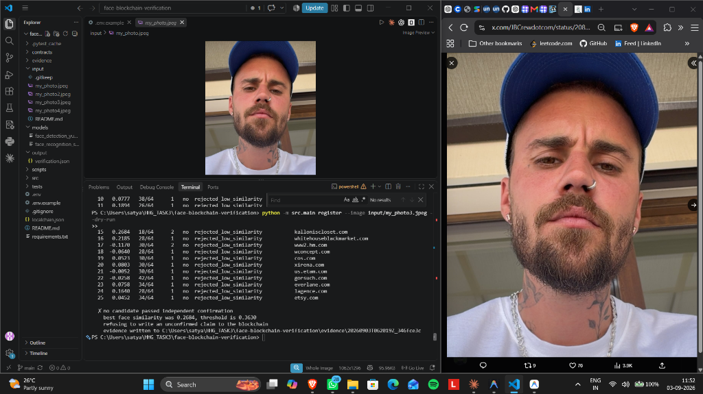

<div align="center">


<br/>


**Find where an image was published, re-check every lead locally, and anchor a hash of the evidence
record on an EVM chain — without putting faces, embeddings or the source URL on-chain.**

</div>

> [!IMPORTANT]
> **This is an image-provenance tool, not an identity-recognition product.** It never maps a face to a
> person. A record says *what the pipeline measured* and *that its hash was registered at a time*; it does
> not prove the claim is true, that a page is authentic, or who appears in a picture.

## Contents

[What it does and does not prove](#what-it-does-and-does-not-prove) · [Architecture](#architecture-and-data-flow) ·
[Install](#install) · [Configuration](#configuration-reference) · [Local-only demo](#local-only-demo-no-network-no-keys-no-gas) ·
[Real search & consent](#real-search-and-explicit-consent) · [Register & verify](#register-and-verify) ·
[Match types](#match-types-and-decision-policy) · [Records](#evidence-records) · [Smart contract](#smart-contract-and-deployment) ·
[Web app](#local-web-app) · [Tests & CI](#testing-linting-and-ci) · [Security](#security-considerations) ·
[Limitations](#limitations-and-responsible-use) · [Troubleshooting](#troubleshooting) · [Licence](#licence-and-attributions)

## What it does and does not prove

| It can show | It cannot show |
|---|---|
| This tool, run at time *T*, measured the recorded scores for the recorded candidate image. | That the matched image is the original, authentic or lawfully published. |
| The sealed record has not been edited since sealing (hash recomputed offline). | That the claim in the record is *true* — anchoring proves registration of a hash, not truth. |
| A hash was registered on-chain at a block/time, and the record's URL matches the on-chain commitment. | Who published the URL, or that it was live at registration time. |
| For a **face match**: a face in the candidate scored ≥ the threshold against the query face under SFace. | Identity. A similarity score is not a person; look-alikes, age and pose change scores. |
| For an **image derivative**: the candidate is perceptually similar to the query image (pHash). | That the same face or person appears — a pHash-only match is *image similarity*, and is labelled so everywhere. |

## Architecture and data flow



* **Local:** face detection/embedding, candidate re-checking, hashing, sealing, local verification, the
  offline fixture/stub, the simulated chain.
* **Third-party (opt-in):** the search provider (and, for URL-only providers, a public image host); the
  candidate image hosts you download from; the RPC node. See [consent](#real-search-and-explicit-consent).
* **On-chain:** the 32-byte payload hash and a 32-byte keccak256 commitment of the URL. Never the URL,
  an embedding, or an image.

<div align="center"></div>

## Install

Python 3.10+ is required by design (`int.bit_count`). The suite was run on **Python 3.13.13**
(Windows 11). The CI workflow targets 3.11–3.13 on Linux; it has **not** been run from this checkout, and
3.10 is untested.

```bash
python -m venv .venv
.venv\Scripts\Activate.ps1            # Windows;  Linux/macOS: source .venv/bin/activate
pip install -r requirements.txt -c constraints.txt      # reproducible, tested versions
python scripts/fetch_models.py                          # ~37 MB, verified against pinned SHA-256
python -m src.main doctor --offline
```

* **Dependency strategy:** ranges in `requirements*.txt` (what the code needs), exact tested pins in
  `constraints.txt` (what was run), no second system. Dev/CI extras: `requirements-dev.txt`; web app:
  `requirements-web.txt`.
* **web3.py 7.x** is required (the client uses the v7 API; v6 is no longer supported).
* **Models** come from the official [OpenCV Zoo](https://github.com/opencv/opencv_zoo)
  (`face_detection_yunet_2023mar.onnx`, `face_recognition_sface_2021dec.onnx`). The pins in
  `scripts/fetch_models.py` are the `oid sha256` / `size` values from the Zoo's own git-lfs pointer files,
  confirmed equal to the downloaded files. Downloads are atomic and a mismatching file is deleted.
  Weights are git-ignored. YuNet is MIT-licensed and SFace Apache-2.0 per the Zoo (checked 2026-10-29).
  A newer YuNet (`2026may`) exists; the model was deliberately not changed.

## Configuration reference

Values come from the process environment, then `.env` (never committed; `doctor` never prints secrets).
Copy `.env.example` to `.env`. Numeric values are validated at start-up.

| Variable | Default | Meaning |
|---|---|---|
| `SEARCH_PROVIDER` | `serpapi_lens` | `serpapi_lens` · `tineye` · `local_fixture` (offline test provider) |
| `SERPAPI_KEY` / `TINEYE_API_KEY` | – | provider keys |
| `FIXTURE_PATH` | – | candidates JSON for `local_fixture` (or `--fixture`) |
| `PUBLISH_PROVIDER` | **`none`** | public image host used only with `--consent-public-upload`: `catbox` · `uguu` · `imgbb` · `none` |
| `IMGBB_API_KEY` | – | for `imgbb` |
| `CHAIN_NAME` / `CHAIN_ID` / `RPC_URL` / `EXPLORER_BASE` | Base Sepolia | target chain; the client refuses a chain-id mismatch |
| `PRIVATE_KEY` | – | **burner** key, needed only to deploy/register; never for verification |
| `CONTRACT_ADDRESS` | – | a **v2** registry (validated as an address; v1 is detected and rejected) |
| `FACE_COSINE_THRESHOLD` | `0.363` | in (−1, 1]. OpenCV's documented SFace example value; not calibrated for your data |
| `PHASH_MAX_DISTANCE` | `12` | 0–64 Hamming distance |
| `MAX_CANDIDATES` | `25` | 1–100 candidates downloaded and checked |
| `EVIDENCE_RETENTION_DAYS` | `0` | default age for `purge-evidence` (0 = none; nothing is deleted automatically) |
| `PROJECT_DIR` | repo root | where `models/`, `output/`, `evidence/`, `localchain.json` live |

## Local-only demo (no network, no keys, no gas)

```bash
python -m src.main register --image tests/data/query.png --fixture tests/data/candidates.json \
    --engine stub --allow-offline-stub --dry-run
python -m src.main verify --record output/verification.json --dry-run
python -m src.main tamper-demo --record output/verification.json --dry-run
```

This exercises everything except real recognition, a real search and a real chain. It cannot be mistaken
for the real thing: the stub engine and fixture each refuse to run without `--allow-offline-stub`, print
banners, and the record carries `test_mode`, `"offline_stub": true`, a `TEST ONLY` claim prefix and a
`-simulated` network name; `verify` repeats all of it. The fixtures are synthetic images (no faces).

Real excerpt from running exactly the first two commands (this checkout, 2026-10-29):

```text
  [1/2] x.com: FACE MATCH  cos=1.0000  pHash= 8/64  faces=1  [social]
  [2/2] example.org: rejected    cos=-0.0494  pHash=37/64  faces=1
  ...
  [OK] payload canonicalized (2637 bytes, sha256-jcs-rfc8785-restricted-v1)
-> Anchoring (SIMULATED local chain)
  ! --dry-run: writing to a SIMULATED local file, not a blockchain
  ...
  [OK] RECORD VERIFIED: UNMODIFIED, ANCHORED, URL COMMITMENT MATCHES
    Not checked: image_binding, evidence_bundle.
    SIMULATED: this was checked against a local JSON file, NOT a blockchain.
    TEST-ONLY: the record itself came from a stub engine/fixture.
```

(The stub scores `1.0000` because the "face" is the whole synthetic image; that is the point of calling it
a stub.)

## Real search and explicit consent

Two steps send your photo (or a link to it) to someone else, so neither runs without a flag:

| Step | Who gets what | Flag |
|---|---|---|
| Public upload (only for URL-only providers when no `--image-url`) | `catbox.moe` (fallback `uguu.se`) or `imgbb.com`: the **full image file, publicly reachable** | `--consent-public-upload` |
| External search | **SerpApi → Google Lens**: a public URL of the image + your API key. **TinEye**: the full image file + your API key | `--consent-external-search` |

```bash
# SerpApi needs a public URL: host the image yourself and pass it (no upload happens)
python -m src.main register --image input/photo.jpg --consent-external-search \
    --image-url https://example.com/my-photo.jpg
# or let the tool upload it (PUBLISH_PROVIDER must not be 'none')
python -m src.main register --image input/photo.jpg --consent-external-search --consent-public-upload
```

Without consent the command prints exactly what *would* be sent and stops: `nothing has been sent`.
`PUBLISH_PROVIDER` defaults to `none`; if it is `none` and a public URL is needed the run fails with an
actionable message instead of uploading. This project makes **no retention or deletion promise** about any
third party — consult their terms. A provider outage, quota error or malformed response is reported as a
technical failure (exit 1), never as "no match".

Minimising local data: `--minimal-evidence` skips face crops, the matched image bytes and the comparison
image. Rejected candidates' bytes and face crops are never kept. `python -m src.main purge-evidence
--older-than-days N [--yes]` deletes old bundles (dry-run by default; `output/` records are never touched).

## Register and verify

```bash
python -m src.main doctor                       # readiness; prints no secrets
python -m src.main register --image input/photo.jpg --consent-external-search --image-url https://...
python -m src.main verify --record output/verification.json --image input/photo.jpg \
    --evidence-dir evidence/<run> --json
python -m src.main tamper-demo --record output/verification.json
```

`verify` runs separate checks and reports each one: **local integrity**, **image binding** (optional),
**evidence bundle** (optional), **chain anchor**, **URL commitment**. It says *verified* only if every
check the claim needs ran **and passed**; a check that could not run is never a pass.

| Exit | Meaning |
|---|---|
| 0 | verified / success |
| 1 | error (bad arguments, missing config, consent refused, provider/technical failure, malformed record) |
| 2 | local failure: payload modified, wrong image, bad evidence bundle, unsupported algorithm |
| 3 | not anchored: hash not on-chain (never registered, or edited and re-sealed) |
| 4 | anchor conflict: anchored, but the on-chain URL commitment differs from the record |
| 5 | no confirmed match (the pipeline ran and found nothing) |
| **6** | **inconclusive**: a required check could not run (RPC down, incompatible/v1 contract, failed commitment lookup) |

`--json` prints a machine-readable result (`verdict`, `checks`, `chain`, `simulated`, `test_only`,
`exit_code`) on stdout with the human log on stderr. Exit 6 and 1 are new/clarified relative to earlier
builds, which treated a failed URL-commitment lookup as success.

**Dry run vs real chain.** `--dry-run` writes to `localchain.json` — a plain JSON file with the registry's
first-write-wins semantics. It is *not* a blockchain; the network is named `…-simulated`, the anchor says
`"simulated": true`, and `verify` says so. `verify` needs no key or gas against a real chain.

## Match types and decision policy

Each candidate is downloaded (SSRF-guarded), re-analysed with the same detector/embedder, and measured
two ways. The outcome names *which* evidence supported it:

| Outcome | Rule | Registerable? | Claim wording |
|---|---|---|---|
| `confirmed_face_match` | some face in the candidate: cosine ≥ threshold | yes — `evidence_type: face_match` | a face scored at/above the threshold; a similarity measurement, **not an identity statement** |
| `confirmed_image_derivative` | pHash distance ≤ max **and the face test did not pass** | yes — `evidence_type: image_derivative` (or excluded with `--require-face-match`) | perceptually similar; **face matching did NOT independently confirm a match** |
| `rejected_low_similarity` | face present, neither test passed | no | – |
| `rejected_no_face_in_candidate` | no usable face, pHash too far | no | – |
| `skipped_no_image_url` / `skipped_download_failed` / `skipped_url_blocked` / `skipped_analysis_failed` | measurement could not be made | no — **not** a negative result | – |

Both checks are always recorded (`face_check_passed`, `image_derivative_check_passed`). If both pass the
outcome is the stronger `confirmed_face_match`. The old rule — "face OR pHash" — is kept because it finds
resized/re-encoded copies, but it no longer presents a pHash-only hit as a face match. Boundaries are
inclusive; a non-finite score or a candidate with no embeddable face can never pass the face test.

**Selection is deterministic:** face match before image derivative; then social-media domains; higher cosine;
lower pHash; earlier provider position; then page URL and image URL as final tie-breaks — independent of
input order. If every candidate was *skipped* (nothing measurable) the run exits 1, not 5. When several faces
are found in the **query** image the largest is used (a warning is printed); in a candidate, the best-matching
face is scored and the face count is recorded.

## Evidence records

`output/verification.json` (schema `faceverify/v2`) holds the sealed `payload`, `integrity`
(`sha256-jcs-rfc8785-restricted-v1`) and the post-hoc `anchor`. The evidence bundle in `evidence/<run>/`
holds the raw search response, candidate score table (rejections included), crops and manifest. Full format,
the canonicalization limits, historical-record handling and what the manifest cannot prove:
**[docs/RECORD_FORMAT.md](docs/RECORD_FORMAT.md)**.

Short version: canonicalization is a **restricted profile of RFC 8785** — byte-identical to JCS for what it
accepts, but it rejects floats and integers beyond ±(2⁵³−1) and ill-formed Unicode — so it is *not* called
"RFC 8785 compliant". Records written by earlier builds (`sha256-jcs-rfc8785`) still verify under their own
rules and are never re-interpreted. The stored `embedding_commitment_sha256` is a commitment to the face
embedding, not anonymisation; no raw embedding is ever saved.

## Smart contract and deployment

`contracts/VerificationRegistry.sol` (Solidity 0.8.24, optimiser 200 runs) is append-only: first write wins,
no owner/admin/upgrade/delete, zero hashes rejected, `exists` is explicit for unknown hashes, the submitter
and block metadata are recorded.

**Registry v2 stops publishing the source URL.** The previous interface took the plaintext URL as calldata
and emitted it in an event, so a URL could be read from the chain forever. v2 takes only
`keccak256(exact URL bytes)`, computed by the client; calldata is exactly selector + two `bytes32`s and the
event carries only hashes (`tests/test_registry_evm.py` checks calldata, logs and storage on an in-process
EVM). Anyone holding a URL can re-hash it and compare. The commitment is **not secret against guessing** and
does not prove the URL is authentic or when it was published.

> [!WARNING]
> **Nothing has been deployed or sent by this work.** The v2 contract was compiled (solc 0.8.24) and run on an
> in-process EVM only; v2 needs a **new manually authorised deployment**. An old v1 deployment is rejected
> with a clear error (and `verify` exits 6), and a plaintext URL ever sent to a v1 contract stays public. No
> deployment address is claimed. Procedure and migration notes: **[docs/DEPLOYMENT.md](docs/DEPLOYMENT.md)**.
> `deploy` refuses to spend gas without `--yes`; `deploy --compile-only` is safe.

## Local web app

A thin local UI over the *same* pipeline: React + TypeScript + Vite frontend (`web/`), FastAPI backend
(`src/web/`). Nothing in the UI is mocked — progress is the pipeline's real stage list, candidates and scores
are its real table, the record/manifest are its real files.

```bash
pip install -r requirements-web.txt -c constraints.txt
(cd web && npm ci && npm run build)
python -m src.web                  # http://127.0.0.1:8765  (loopback only)
python -m src.web --demo           # + stub engine and offline fixture, labelled on every screen
```

Journey: upload + preview → privacy panel and consent boxes (what is sent to whom) → job with real stage
status → candidates table with outcome labels in text, face-match vs image-derivative evidence, comparison
image, claim and limitations → download record/manifest → "Verify this record" and a separate *Check a
record* tab (record + optional original image; per-check PASS / FAIL / COULD NOT RUN / NOT CHECKED).

Safety: loopback by default (a warning if you change `--host`; there is no authentication); `Host`/`Origin`
checks; uploads ≤ 10 MiB validated as bounded images; one worker, short queue; each job in a private temp
dir, deleted on `DELETE`, after 1 h and on shutdown; only whitelisted artefact names are served; no endpoint
fetches a URL for the client; real-chain registration needs `--allow-chain-writes` (otherwise the simulated
chain is used, labelled); no stack traces or secrets in responses. A running pipeline step cannot be
interrupted — "cancel" discards its result when it finishes (shown as *cancelling*).

Verified: 23 API tests (real pipeline in demo mode) and one manual browser run — register on the synthetic
fixture and verify the resulting record in the built-in browser. **Not done:** automated browser tests, the
Tailwind/shadcn styling and persistent case management from the vision document (see `FACEPROOF_VISION.md`).

## Testing, linting and CI

```bash
python -m pytest tests -q                     # hermetic: no network, keys, wallet or gas
pip install -r requirements-dev.txt           # adds ruff, mypy, eth-tester (in-process EVM)
ruff check src tests scripts && ruff format --check src tests scripts && mypy
(cd web && npm ci && npm run build)
```

Last run in this checkout (Python 3.13.13, Windows): **578 passed** with the dev extras (in-process EVM,
real model weights, web API); **557 passed, 1 skipped** without `eth-tester` (the EVM module skips with a
reason). The earlier README's "258 tests" was a historical figure. Coverage includes: all match outcomes and
boundaries, deterministic selection, claim wording, fail-closed verification paths, SSRF/redirect/size/decode
limits (including a real loopback server unreachable through the guarded session), consent gates, secret
redaction, record/bundle tampering, RFC 8785 vectors + a JavaScript cross-check, and contract behaviour
(duplicate/zero/unknown, no URL in calldata/events/storage, v1 detection, receipt/timeout/RPC failures).

`.github/workflows/ci.yml` runs lint, format, mypy, compile, tests and contract compilation on Python
3.11–3.13, plus the frontend build — no secrets, no downloads of models, no transactions, no
`continue-on-error`. It was validated as YAML but **has not been executed on GitHub**. `ruff format` is
enforced for new/rewritten files; pre-existing modules listed in `pyproject.toml` are excluded to avoid a
repo-wide reformat.

## Security considerations

* **SSRF:** candidate URLs are untrusted. Only `http(s)` on ports 80/443, no credentials or control
  characters; every hop incl. redirects (max 3, manual, loop-checked) is re-validated; all resolved addresses
  must be globally routable (IPv4/IPv6; mapped/6to4/NAT64/Teredo unwrapped); the TCP connect is **pinned to
  the validated IP** (DNS-rebinding), proxies/`.netrc`/env are ignored; 25 MiB, 20 s/request, 45 s total,
  image content types only. *Residual:* validation trusts the OS resolver's answers; a public host can still
  serve hostile content; the guard cannot see through an HTTPS-terminating intermediary you control.
* **Decoded images:** header dimensions are read before decoding (≤ 16384 px/side, ≤ 50 MP), formats limited
  to JPEG/PNG/WebP/GIF/BMP, dtype/shape validated, fetch concurrency bounded. Local files named by a search
  result are refused (only the offline fixture may reference disk paths).
* **Secrets:** `doctor` shows only "set (N chars)"; RPC URLs are reduced to scheme+host; provider/RPC errors
  never echo URLs or keys; `PRIVATE_KEY` problems never echo key material. Use a burner key.
* **Fail-closed verification, deterministic claims, unsupported algorithms rejected** — see above.
* **Biometric data:** embeddings are never saved or sent; only a SHA-256 commitment is recorded and should be
  treated as personal data. Crops/downloaded bytes are local evidence you control (`--minimal-evidence`,
  `purge-evidence`).

## Limitations and responsible use

* Thresholds are model- and data-dependent; the face test has **not** been evaluated here (no licensed face
  data) and no fairness claim is made — see **[docs/EVALUATION.md](docs/EVALUATION.md)**.
* pHash misses heavy crops and mirrored copies (measured on synthetic images); the face test may miss small,
  blurred or angled faces; both can err.
* Only the largest query face is used; group photos need cropping.
* Search coverage is whatever the provider indexes; social platforms often block hotlinked images.
* Use only images you have the right to process, and obtain consent from the people shown. Do not use this to
  identify, track or profile people. A record is not legal proof of anything.
* v1-anchored records cannot be checked through the v2 client; the v2 contract is undeployed.

## Troubleshooting

| Symptom | Cause / fix |
|---|---|
| `this step sends data to a third party and needs your explicit consent` | add `--consent-external-search` (and `--consent-public-upload` if it lists it) — or use the offline demo |
| `PUBLISH_PROVIDER is 'none'` | pass `--image-url` for a host you control, or set a provider and consent to the upload |
| exit 6 / `inconclusive` | a required check could not run: see the `error` lines — RPC unreachable, `CONTRACT_ADDRESS` is a v1 registry or has no code, lookup timeout |
| `does not expose registryVersion()` | the address is an old v1 registry; deploy v2 ([docs/DEPLOYMENT.md](docs/DEPLOYMENT.md)) |
| `chain id mismatch` | `CHAIN_ID` differs from what the RPC reports |
| `no face detected` | clearer, front-facing, ≥ ~60 px face; `doctor` confirms models are present |
| `missing model … / checksum does NOT match` | `python scripts/fetch_models.py` (it re-verifies and replaces bad files) |
| `no candidate could be evaluated - NOT a negative result` | every candidate was skipped (blocked/failed downloads); retry or raise `MAX_CANDIDATES` |
| `URL refused by the safety guard` | the candidate pointed at a private/loopback/odd-port address; intended |
| web UI says it cannot reach the API | start `python -m src.web`; build the frontend with `npm run build` |

## Historical screenshots and assets

`assets/demo_confirmed_match.png` and `assets/demo_rejected_claim.png` are screenshots of runs made with an
**earlier build** (older wording such as "CONFIRMED", contract v1 interface). The visible command line in them
includes `--dry-run`, i.e. **the anchoring in those runs used the simulated local chain, not Base Sepolia**.
They show other people's photographs from public posts; consider whether keeping them in a public repository
is appropriate. They are retained as history, not as evidence of current behaviour or of any on-chain
transaction.

<div align="center">


</div>

`assets/terminal_card.svg` is a **hand-authored illustration, not a captured session**; its block number and
transaction hash are decorative and cannot be reproduced, so it is not embedded here.

## Licence and attributions

**There is no `LICENSE` file in this repository, and none was created.** `contracts/VerificationRegistry.sol`
carries an `SPDX-License-Identifier: MIT` tag, but that does not license the rest of the project; the earlier
README's MIT badge linked to a file that does not exist. Choosing a licence is the owner's decision.
Third-party: OpenCV (Apache-2.0); OpenCV Zoo YuNet (MIT) and SFace (Apache-2.0) weights, downloaded not
bundled; web3.py, eth-account, py-solc-x, requests, FastAPI, React, Vite under their own licences. SFace:
[arXiv 2205.12010](https://arxiv.org/abs/2205.12010).

Further reading: [RFC 8785](https://www.rfc-editor.org/rfc/rfc8785) ·
[OWASP SSRF cheat sheet](https://cheatsheetseries.owasp.org/cheatsheets/Server_Side_Request_Forgery_Prevention_Cheat_Sheet.html) ·
[Web3.py](https://web3py.readthedocs.io/) · [Solidity](https://docs.soliditylang.org/) ·
[OpenCV](https://docs.opencv.org/) · [Base docs](https://docs.base.org/).
