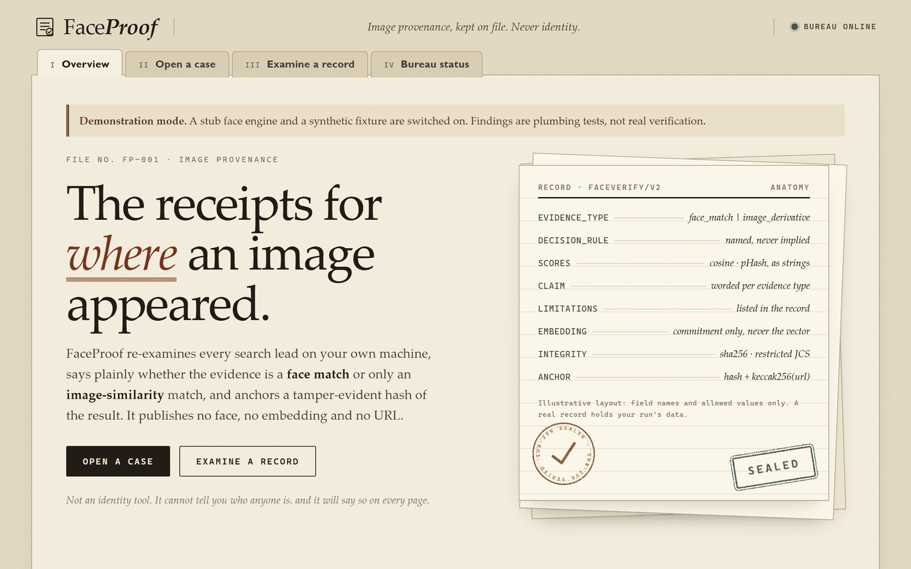
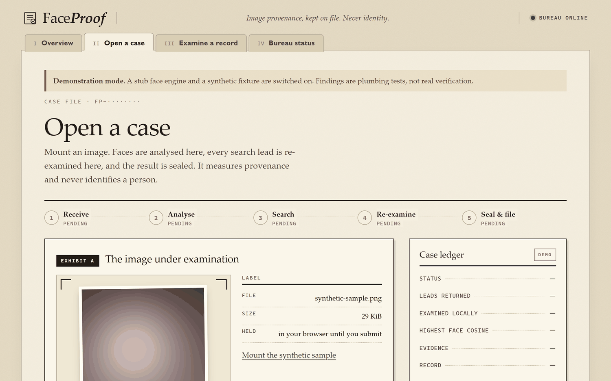
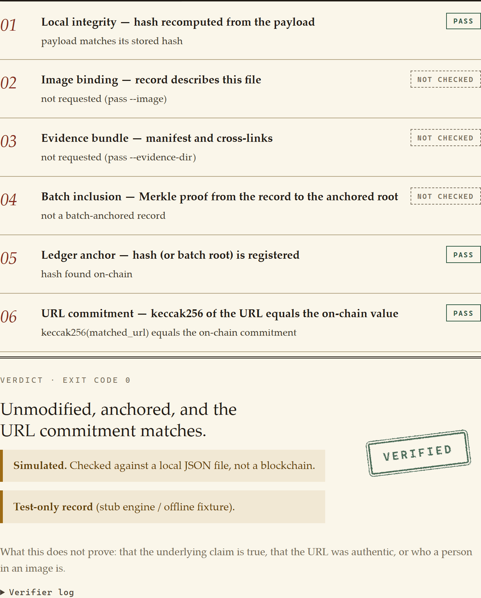
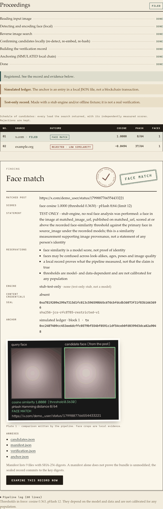

<div align="center">


<br/>


**Image provenance, kept on file.**<br/>
Find where an image appeared, re-examine every lead on your own machine, say plainly whether the evidence is a *face match* or only *image similarity*, and anchor a tamper-evident hash — without putting a face, an embedding or a URL on-chain.

[Landing page](#the-app) · [Pipeline](#the-pipeline) · [Measured results](#measured-results) · [Quickstart](#quickstart) · [CLI](#cli) · [Security](#security-and-privacy) · [Limits](#what-is-not-done-and-what-is-not-claimed)

</div>

> [!IMPORTANT]
> **This is an image-provenance tool, not an identity-recognition product.** It never maps a face to a person. A record says *what the pipeline measured* and *that its hash was registered at a time*. It does not prove a claim is true, that a page is authentic, or who appears in a photograph.

---

## At a glance

<table>
<tr>
<td width="33%" valign="top">

**Honest evidence**<br/>
Every accepted candidate carries exactly one label: *face match* or *image derivative*. A hash-only match is never described as a face match, and a check that could not run is *inconclusive*, never a pass.

</td>
<td width="33%" valign="top">

**Local by default**<br/>
Detection, embedding, re-checking, hashing and verification run on your machine. Search and public upload are opt-in, per run, with the exact data flow shown first.

</td>
<td width="33%" valign="top">

**Measured, not claimed**<br/>
Models are benchmarked on public LFW, stress-tested, and the raw results are in the repo. What was *not* measured is listed as plainly as what was.

</td>
</tr>
</table>

## The app

A local web app over the same pipeline — React + TypeScript frontend, FastAPI backend, loopback-only. Nothing in it is mocked: stages, scores, records and manifests are the pipeline's real output.

<div align="center">

</div>

<details>
<summary><b>Watch a full run</b> — mount an image, examine, seal, then examine the sealed record</summary>
<br/>
<div align="center">


<sub>Real capture of the app in <b>demo mode</b> (stub engine, synthetic fixture, simulated ledger), produced by <code>scripts/capture_screenshots.py</code>.</sub>
</div>
</details>

<table>
<tr>
<td width="50%" valign="top">

<sub><b>Open a case.</b> Image mounted; the disclosure notice states exactly what a provider would receive before anything is sent.</sub>
</td>
<td width="50%" valign="top">

<sub><b>Examine a record.</b> Six numbered checks resolve one by one; <i>NOT CHECKED</i> and <i>COULD NOT RUN</i> are never shown as a pass.</sub>
</td>
</tr>
</table>

<details>
<summary><b>A finished case</b> — proceedings, schedule of candidates, finding sheet</summary>
<br/>
<div align="center"></div>
<sub>Rejections stay in the schedule. The finding carries its statement, its reservations, the engine and licence, the content-credentials state and the seal. This demo run is labelled <i>test-only</i> and <i>simulated</i> because it is.</sub>
</details>

```bash
pip install -r requirements-web.txt -c constraints.txt
(cd web && npm ci && npm run build)
python -m src.web            # http://127.0.0.1:8765, loopback only
python -m src.web --demo     # adds the stub engine + synthetic fixture, labelled on every screen
```

## The pipeline

<div align="center">

</div>

| Stage | What it does | Why this way |
|---|---|---|
| **Detect** | SCRFD-10G with 5-point landmarks, multi-scale letterbox, low-threshold retry when nothing is found | Current detector generation; recovers hard faces without extra inference |
| **Embed** | Least-squares similarity alignment → ArcFace (R50 / R100), 512-d, flip test-time augmentation, ONNX Runtime (CUDA if present) | ArcFace-family accuracy; `opencv` (YuNet + SFace) remains the permissive default |
| **Subject** | Face with the highest *prominence* (size × centrality); warns when a second face is comparable | Measured: "largest face" is wrong often enough to cost 2.4 points of accuracy |
| **Search** | Reverse-image provider returns *leads*, never findings | Needs explicit consent; failures are errors, never "no match" |
| **Download** | SSRF-guarded (IP-pinned, redirect-checked, size/pixel-bounded), bounded parallel pool | 4× faster at simulated latency; results still consumed in order |
| **Re-examine** | Face cosine, geometric verification (SIFT + RANSAC), pHash — per candidate | Three tiers of evidence, each labelled for what it can and cannot show |
| **Seal** | Restricted RFC 8785 canonical JSON → SHA-256; schema `faceverify/v2` | Deterministic, honestly named; old records still verify under their own rules |
| **Anchor** | One transaction per record, or one Merkle root for many | Hash + keccak256(URL) only; never a face, vector or URL |

### Evidence ladder

<div align="center">

</div>

* **Geometric verification** recovers what a 64-bit pHash misses — crops, rotations, mirrored copies — and is *explainable*: the record stores how many local features agree on one transform. It was validated on synthetic images only; repeated textures, text and logos in real photos can create spurious matches (stated in the record's reservations).
* **C2PA Content Credentials** on the source and matched image are read as independent provenance evidence. `valid` means signature and hashes verify, **not** that the signer is trusted (reported separately); `absent` proves nothing; `ai_generated` is only what the signer's manifest declares.
* Selection among candidates is deterministic: face match → social domain → higher cosine → lower pHash → provider position → URL, independent of input order.

## Measured results

<div align="center">

</div>

Full LFW protocol (6,000 pairs, 7,701 **raw, unaligned** images through the full detect → align → embed path), 10-fold cross-validated. The chart is drawn from [`docs/results/lfw_benchmark.json`](docs/results/lfw_benchmark.json) by `scripts/make_readme_assets.py`; reproduce with `scripts/benchmark_face.py`.

| | SFace (MIT / Apache-2.0) | ArcFace-R50 | ArcFace-R100 |
|---|---|---|---|
| 10-fold accuracy | 99.32% ± 0.36 | **99.65% ± 0.29** | 99.63% ± 0.29 |
| EER | 0.83% | **0.60%** | 0.67% |
| True accepts @ FAR 1e-3 | 98.47% | **99.33%** | 99.30% |
| Probe downscaled 5× | 94.3% | **99.5%** | 99.3% |
| Probe rotated 30° | 90.2% | **99.7%** | 99.5% |
| Latency, 1280 px | 169 ms (CPU) | **21 ms (GPU)** | 26 ms (GPU) |

**Read this honestly.** LFW is near-saturated — the clean-accuracy gap is small and R100 is not better than R50 here; the stressed probes and the FAR-1e-3 point are where the newer models clearly separate. The GPU/CPU latency comparison is of *setups* (RTX 4050 laptop GPU vs this CPU), not of models. Each stress cell is 600 pairs, so ~1-point differences are noise. SFace's documented threshold (0.363) landed almost exactly on its measured FAR-1e-3 point (0.359) — an independent sanity check. IJB-C, CFP-FP, AgeDB, masks, age gaps and any demographic breakdown were **not** measured, and no fairness claim is made. Details and every caveat: [docs/EVALUATION.md](docs/EVALUATION.md).

> [!WARNING]
> **Licences.** The ArcFace/SCRFD weights come from the InsightFace project for **non-commercial research use only**. The licence is written into every record and printed by the CLI; the default engine (`opencv`) is permissively licensed.

### Merkle-batched anchoring

<div align="center">

</div>

`register --anchor-mode batch` seals records without anchoring; `anchor-batch` registers one RFC 6962 root for all of them and writes each record its inclusion proof. The leaf binds the URL commitment, so a valid proof also proves the URL matches. Measured on an in-process EVM: one record **74,464** gas; a batch of 1 **74,174**; a batch of 1,000 **74,186** — about **74 gas per record**. Real chains add calldata and L1-data fees, which this does not model. The tree matches Certificate Transparency reference values, an independent implementation and exhaustive proofs. **Registry v3 is compiled and tested, not deployed** — see [docs/DEPLOYMENT.md](docs/DEPLOYMENT.md).

## Quickstart

```bash
python -m venv .venv && source .venv/bin/activate        # Windows: .venv\Scripts\Activate.ps1
pip install -r requirements.txt -c constraints.txt       # tested, pinned versions
python scripts/fetch_models.py                           # OpenCV Zoo models, SHA-256 verified
python -m src.main doctor --offline
```

**Offline demo — no network, no keys, no gas.** Exercises everything except real recognition, a real search and a real chain, and cannot be mistaken for the real thing: the record is labelled test-only and simulated.

```bash
python -m src.main register --image tests/data/query.png --fixture tests/data/candidates.json \
    --engine stub --allow-offline-stub --dry-run
python -m src.main verify --record output/verification.json --dry-run
```

Real excerpt from running exactly that (this checkout, 2026-10-30):

```text
    C2PA Content Credentials: absent (absence proves nothing)
  [1/2] x.com: FACE MATCH  cos=1.0000  pHash= 8/64  faces=1  [social]
  [2/2] example.org: rejected    cos=-0.0494  pHash=37/64  faces=1
  [OK] payload canonicalized (3385 bytes, sha256-jcs-rfc8785-restricted-v1)
-> Anchoring (SIMULATED local chain)
  [OK] RECORD VERIFIED: UNMODIFIED, ANCHORED, URL COMMITMENT MATCHES
    Passed: hash recomputation, chain anchor, URL commitment.
    Not checked: image_binding, evidence_bundle, merkle_inclusion.
    SIMULATED: this was checked against a local JSON file, NOT a blockchain.
    TEST-ONLY: the record itself came from a stub engine/fixture.
```

(The stub scores 1.0000 because its "face" is the whole synthetic image — that is why it is called a stub.)

**Higher-accuracy engines (optional, non-commercial weights):**

```bash
python scripts/fetch_insightface.py        # SCRFD + ArcFace; checksum-pinned, atomic
python -m src.main register --image photo.jpg --engine auto ...   # best available; r50 preferred
```

**A real run** sends data to third parties, so it needs flags that say so:

```bash
python -m src.main register --image photo.jpg --consent-external-search --image-url https://you.example/photo.jpg
```

Without consent the command prints what *would* be sent and stops — `nothing has been sent`.

## CLI

| Command | Purpose |
|---|---|
| `register` | Full pipeline; `--engine`, `--anchor-mode single\|batch`, `--require-face-match`, `--minimal-evidence`, consent flags |
| `anchor-batch` | One Merkle-root transaction for many sealed records (needs registry v3) |
| `verify` | Recompute, bind to an image, check the bundle, look up the chain; `--json` for machines |
| `tamper-demo` | Shows both forgery classes: naive edit (caught offline) and re-sealed edit (caught by the ledger) |
| `search` | Search stage only |
| `doctor` | Readiness; never prints a secret |
| `purge-evidence` | Delete old local bundles (dry run by default) |
| `deploy` | Compile / deploy the registry; refuses to spend gas without `--yes` |

| Exit | Meaning |
|---|---|
| 0 | verified / success |
| 1 | error (config, consent refused, provider failure, malformed record) |
| 2 | local failure: modified payload, wrong image, bad bundle, unsupported algorithm |
| 3 | not anchored |
| 4 | anchor conflict (URL commitment or inclusion proof) |
| 5 | no confirmed match |
| **6** | **inconclusive** — a required check could not run (RPC down, incompatible contract, failed lookup). Never a pass. |

## Security and privacy

<details>
<summary><b>Network:</b> SSRF-guarded fetching of untrusted URLs</summary>

Only `http(s)` on ports 80/443, no credentials; every hop including redirects (max 3, manual, loop-checked) is re-validated; every resolved address must be globally routable (IPv4/IPv6, mapped/6to4/NAT64/Teredo unwrapped); the TCP connect is **pinned to the validated IP** (DNS-rebinding); proxies and environment are ignored; 25 MiB, 20 s per request, 45 s total, image content types only. Headers are read before decoding (≤ 16384 px per side, ≤ 50 MP). A real loopback server is unreachable through the guarded session (tested). *Residual:* trusts the OS resolver; a public host can still serve hostile content.
</details>

<details>
<summary><b>Consent:</b> nothing leaves the machine without a flag</summary>

External search and public upload each need their own flag; `PUBLISH_PROVIDER` defaults to `none`; the disclosure names the service and what it receives. No retention or deletion promise is made for any third party. `--minimal-evidence` keeps no face crops or downloaded bytes; rejected candidates' bytes are never kept; `purge-evidence` removes old bundles.
</details>

<details>
<summary><b>Chain:</b> what goes on the public ledger</summary>

Calldata is exactly selector + two `bytes32` (single) or selector + root + size (batch); events carry only hashes. The URL is never sent — only `keccak256(url)`, which is not secret against guessing and does not prove authenticity. Embeddings are never saved, sent or written on-chain; the stored fingerprint is a *commitment*, not anonymisation. Duplicate, zero and unknown cases, chain-id mismatch, reverted receipts and RPC timeouts are all tested on an in-process EVM.
</details>

<details>
<summary><b>Verification fails closed</b></summary>

`verified` requires every check the claim needs to have run **and passed**. An unreachable chain, a v1/incompatible contract or a failed commitment lookup is *inconclusive* (exit 6). Unknown integrity algorithms fail; historical records verify under their original rules and are never re-interpreted. Canonicalization is a *restricted* RFC 8785 profile and is named as such.
</details>

<details>
<summary><b>Web app</b></summary>

Loopback by default; `Host`/`Origin` checks; uploads ≤ 10 MiB validated as bounded images; one worker and a short queue; per-job temp directories deleted on request, after 1 h and on shutdown; only whitelisted artefacts served; real-chain writes need `--allow-chain-writes`; no stack traces or secrets in responses. There is **no authentication**: do not expose it.
</details>

## Configuration

| Variable | Default | Meaning |
|---|---|---|
| `SEARCH_PROVIDER` | `serpapi_lens` | `serpapi_lens` · `tineye` · `local_fixture` (offline) |
| `SERPAPI_KEY` / `TINEYE_API_KEY` | – | provider keys |
| `PUBLISH_PROVIDER` | `none` | public image host, only with `--consent-public-upload` |
| `RPC_URL` · `CHAIN_ID` · `CHAIN_NAME` · `EXPLORER_BASE` | Base Sepolia | target chain; chain-id mismatch is refused |
| `PRIVATE_KEY` | – | **burner** key; only for deploy/register, never for verification |
| `CONTRACT_ADDRESS` | – | a registry v2 or v3 deployment (v1 is detected and rejected) |
| `FACE_COSINE_THRESHOLD` | per engine | if unset, each engine's benchmarked default (SFace 0.363, R50 0.25, R100 0.28) |
| `PHASH_MAX_DISTANCE` | `12` | 0–64 |
| `MAX_CANDIDATES` | `25` | 1–100 |
| `EVIDENCE_RETENTION_DAYS` | `0` | default for `purge-evidence`; nothing is deleted automatically |
| `PROJECT_DIR` | repo root | where `models/`, `output/`, `evidence/` live |

## Engineering

```bash
python -m pytest tests -q                              # hermetic: no network, keys, wallet or gas
pip install -r requirements-dev.txt                    # + ruff, mypy, eth-tester (in-process EVM)
ruff check src tests scripts && ruff format --check src tests scripts && mypy
(cd web && npm ci && npm run build)
python scripts/make_readme_assets.py                   # regenerate the SVGs (benchmark from the JSON)
python scripts/capture_screenshots.py                  # regenerate screenshots + GIF from the live app
```

As of 2026-10-30 (Python 3.13.13, Windows 11): **695 tests pass** with the dev extras (in-process EVM, real model weights, web API, C2PA); **665 pass, 1 skipped** in a clean environment from `requirements.txt` alone (the EVM module skips with a reason). Coverage includes every match outcome and boundary, deterministic selection, fail-closed verification, SSRF/redirect/size/decode limits, consent gates and secret redaction, record and bundle tampering, RFC 8785 vectors with a JavaScript cross-check, RFC 6962 reference values, contract behaviour (duplicates, zero values, v1/v2/v3 detection, calldata and events, gas), SCRFD decode and alignment, geometric verification, C2PA (including a real signed sample and a tampered copy) and download concurrency.

`.github/workflows/ci.yml` runs lint, format, mypy, tests and contract compilation on Python 3.11–3.13 plus the frontend build, with no secrets and no `continue-on-error`. **It has not been run on GitHub.** `ruff format` is enforced for new or rewritten files; older modules are listed as exclusions in `pyproject.toml`.

| Document | What is in it |
|---|---|
| [docs/PIPELINE.md](docs/PIPELINE.md) | Design of each stage and the decisions behind it |
| [docs/EVALUATION.md](docs/EVALUATION.md) | Benchmarks, stress tests, thresholds, and every caveat |
| [docs/RECORD_FORMAT.md](docs/RECORD_FORMAT.md) | Record schema, algorithm labels, anchor modes, bundles, migration |
| [docs/DEPLOYMENT.md](docs/DEPLOYMENT.md) | Registry v2/v3, manual deployment, migration from v1 |

## What is not done, and what is not claimed

* **Registry v3 is not deployed.** It is compiled and tested on an in-process EVM; a real deployment is a manual, deliberate step. A plaintext URL ever sent to an old v1 contract stays public.
* **Face matching is measured on LFW only.** No IJB-C / CFP-FP / AgeDB, no demographic breakdown, one machine. Thresholds are indicative, not calibrated for any population.
* **Geometric verification is validated on synthetic images.** Real photographs may produce false matches (repeated structure, text, logos).
* **One search-provider path is verified end to end** (offline fixture); live SerpApi/TinEye calls need your keys and were not exercised here.
* **The web app is a single-user local tool:** no accounts, no persistence beyond an hour, no hosting setup.
* **CI has not run on GitHub;** Python 3.10–3.12 were not tested locally.
* **There is no `LICENSE` file.** The contract carries an MIT SPDX tag, which does not license the rest. Choosing a licence is the owner's decision. Third-party: OpenCV (Apache-2.0); OpenCV Zoo YuNet (MIT) and SFace (Apache-2.0); InsightFace weights (**non-commercial research**); c2pa-python, web3.py and others under their own licences.
* Use only images you have the right to process and obtain consent from the people shown. Do not use this to identify, track or profile anyone. A record is not legal proof of anything.

<details>
<summary><b>Earlier screenshots in <code>assets/</code></b> (kept as history)</summary>
<br/>

`assets/demo_confirmed_match.png` and `assets/demo_rejected_claim.png` come from an **earlier build** (older wording, contract v1 interface). The command visible in them includes `--dry-run`, so **those anchors used the simulated chain, not Base Sepolia**, and they show other people's photographs from public posts — consider whether to keep them in a public repository. `assets/terminal_card.svg` is a hand-authored illustration, not a captured session. None of these are evidence of current behaviour or of any on-chain transaction. The current screenshots above are generated by `scripts/capture_screenshots.py` from the live app.
</details>

<div align="center"><sub>FaceProof · local-first image provenance · a record shows what was measured and anchored, not that a claim is true</sub></div>
